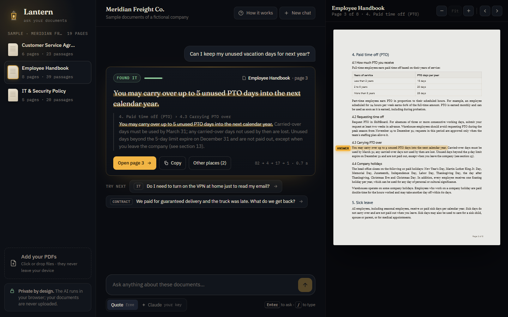
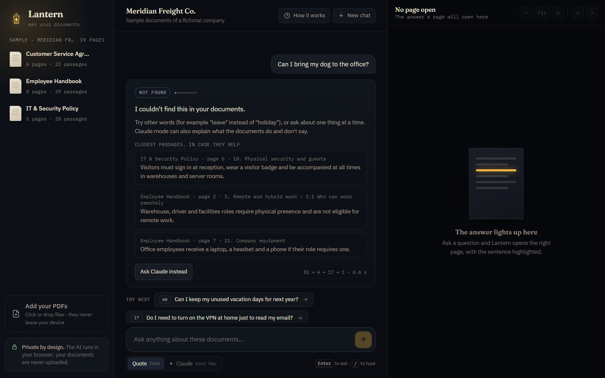
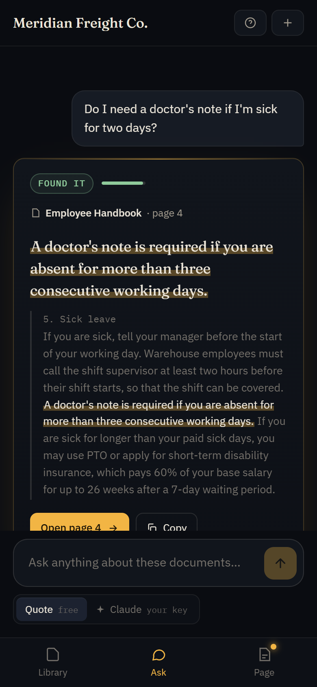

# 🏮 Lantern: ask your documents, get the exact page

**Ask a question about your PDFs in plain words. Lantern points to the sentence that answers it, opens the page with that sentence lit up, and says so honestly when the answer isn't there.**

It runs entirely in the browser: the documents are never uploaded anywhere.



## Why I built it

Every company has documents nobody reads: the employee handbook, the IT policy, customer contracts. People ask HR or a colleague instead, and get answers from memory. Most "chat with your PDF" tools fix this with an AI that *writes* an answer, which reads well but can be confidently wrong, and you can't easily check it.

Lantern takes the other approach: **it quotes**. Every answer is a real sentence from your documents, with its page, so checking takes one click. And when no sentence answers the question, it says *"I couldn't find this in your documents"* instead of inventing something.

| You ask… | Lantern answers… |
|---|---|
| *"Can I keep my unused vacation days for next year?"* | *"You may carry over up to 5 unused PTO days into the next calendar year."* (Employee Handbook, page 3) |
| *"My father passed away. How many days off can I take?"* | *"Bereavement leave: up to 5 paid days after the death of an immediate family member…"* (page 4), with no words in common with the question |
| *"Can I bring my dog to the office?"* | *"I couldn't find this in your documents."* |



## How it works

1. **Read the PDFs.** Each document is cut into passages of about 60 words that never cross a page, so every answer can cite one page. Each passage keeps its section title ("4. Paid time off › 4.3 Carrying PTO over"), and table rows are rewritten as sentences ("Shift: Night · Shift premium: $2.75 per hour").
2. **Search by meaning.** An embedding model (BGE-small) turns every passage, and the question, into 384 numbers that capture meaning. The closest passages win, so *"my father passed away"* finds *"bereavement leave"*.
3. **Read sentence by sentence.** A cross-encoder (bge-reranker-base) reads the question together with each sentence of the 4 closest passages and scores how well it answers.
4. **Point, or admit it.** The best sentence is shown and highlighted on its page. Its score decides the label: **Found it**, **Not certain** (check the page), or **Not found**.

An optional **Claude mode** lets a visitor paste their own Claude API key: Claude then also writes a complete answer from the same passages, with clickable citations. The key stays in the browser tab and only goes to Anthropic.

## How I measured it

I wrote a fictional logistics company, **Meridian Freight Co.**, with 3 realistic documents (19 pages) and **66 test questions** with known answers:

- **22 easy** questions, using the document's own words
- **33 hard** questions, in different words: *"I left my laptop on the train"* when the document says *"lost or stolen device"*
- **11 trick** questions whose answer isn't in the documents, some with misleading words: *"How much does **parking** cost at the head office?"* when "parking" only appears in the travel expenses section

Every evidence sentence is checked word for word against the documents by a script, so the exam itself has no typos.

### Search: meaning beats words, and mixing them hurt

| Search method | Right passage 1st | In top 3 | In top 5 | Hard questions (top 3) |
|---|---:|---:|---:|---:|
| Word search (BM25) | 58% | 82% | 84% | 70% |
| Meaning search (MiniLM) | 82% | 93% | 95% | 91% |
| **Meaning search (BGE-small)** | **84%** | **95%** | **100%** | **91%** |
| Words + meaning (BGE-small) | 75% | 89% | 93% | 82% |

Many RAG tutorials say to always combine word search with meaning search. On these documents it made results worse, so Lantern doesn't.

### Answers: the final pipeline

| | Result |
|---|---:|
| Right sentence chosen (55 answerable questions) | **73%** |
| "Found it" answers that were right | **29 of 32 (91%)** |
| Trick questions answered "Not found" | 6 of 11 |
| Typical answer time in the browser (laptop) | **0.6 s** |

The browser version gives exactly the same results as the Python version on all 66 questions.

## What didn't work, and what I changed

- **An answer model that pulls out the exact words** (SQuAD 2.0, the classic approach) got 77% of easy questions but only 24% of hard ones. It's trained on fact questions like "How long…?", so it gave up on the questions people actually ask, like "Can I…?" and "What should I do if…?". Pointing to the best *sentence* works much better.
- **The small re-ranker couldn't tell when it didn't know.** It was as confident about wrong answers as about right ones. I compared 3 re-rankers. bge-reranker-base was by far the best at separating right answers from trick questions (0.89, where 1.0 is perfect and 0.5 is guessing), so it's the one Lantern uses.
- **No cheating on the confidence threshold.** The score below which Lantern says "Not found" was tuned on half of the questions and graded on the other half, then swapped. Tuning and grading on the same questions would make the numbers look better than they are.
- **36 seconds per answer in the browser at first.** There were two bugs. Every sentence was padded to 512 tokens. And the browser library read the model's vocabulary file differently from Python, because the Python library had re-saved it in a newer format, so the model was reading gibberish. Fixed, it takes 0.6 s.
- **Less work for the same quality.** Re-reading whole passages before scoring sentences turned out to be unnecessary: scoring the sentences of the 4 closest search results directly is as accurate, with 4× less computing.

## Limits

- **It quotes; it doesn't reason.** A question whose answer is spread over several sentences, or needs a calculation, gets the most relevant sentence, not a combined answer. That's what Claude mode is for.
- **It can still be fooled by a shared word.** *"When is the annual bonus paid?"* finds the *referral* bonus. The page link makes this easy to spot.
- **The test set is small and I wrote it myself**, so treat the numbers as a guide, not a guarantee.
- **The first visit downloads about 315 MB of AI models**, with a progress bar. Later visits start instantly.
- **Scanned PDFs** (images without text) can't be read, and uploads are capped at 300 pages.

## Try it on your phone



## Run it yourself

The app needs no install. Serve the `demo/` folder with the security headers that let the browser use several CPU cores:

```
python serve.py
```

Then open http://localhost:8000. You can link straight to a question: `http://localhost:8000/?q=Can I bring my dog to the office?`

To rebuild everything from scratch:

| Script | What it does |
|---|---|
| `eval/check_questions.py` | Checks every test question's evidence word for word against the documents |
| `01_prepare.py` | Reads the PDFs, cuts them into passages, links each question to its passage |
| `02_search.py` | Compares word search, meaning search and both together |
| `03_answer.py [re-ranker]` | Compares answer approaches and re-rankers, tunes the "Not found" threshold |
| `03b_fast_variant.py` | Tests the lighter pipeline used in the browser |
| `04_export.py` | Exports both models to 8-bit ONNX for the browser and checks nothing changed |
| `05_build_demo.py` | Pre-indexes the sample documents for the web app |

Python needs `torch`, `transformers`, `sentence-transformers`, `onnx`, `onnxruntime` and `pymupdf`.

## Built with

Python · PyTorch · Hugging Face Transformers · Sentence-Transformers · ONNX Runtime (Web) · Transformers.js · PDF.js · PyMuPDF · Claude API (optional mode) · plain HTML, CSS and JavaScript

## Credits

- Models: [BAAI/bge-small-en-v1.5](https://huggingface.co/BAAI/bge-small-en-v1.5) (MIT) and [BAAI/bge-reranker-base](https://huggingface.co/BAAI/bge-reranker-base) (MIT). Also tested: all-MiniLM-L6-v2, ms-marco-MiniLM-L-6-v2, mxbai-rerank-xsmall-v1 and tinyroberta-squad2.
- Meridian Freight Co. and its documents are fictional, written for this project.
